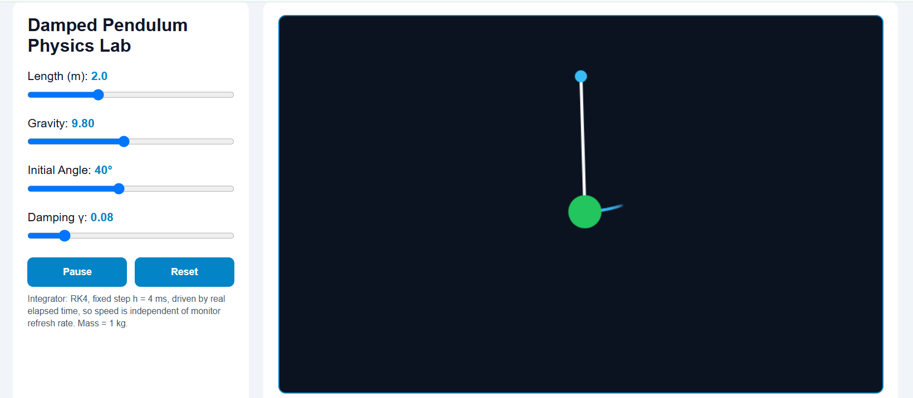
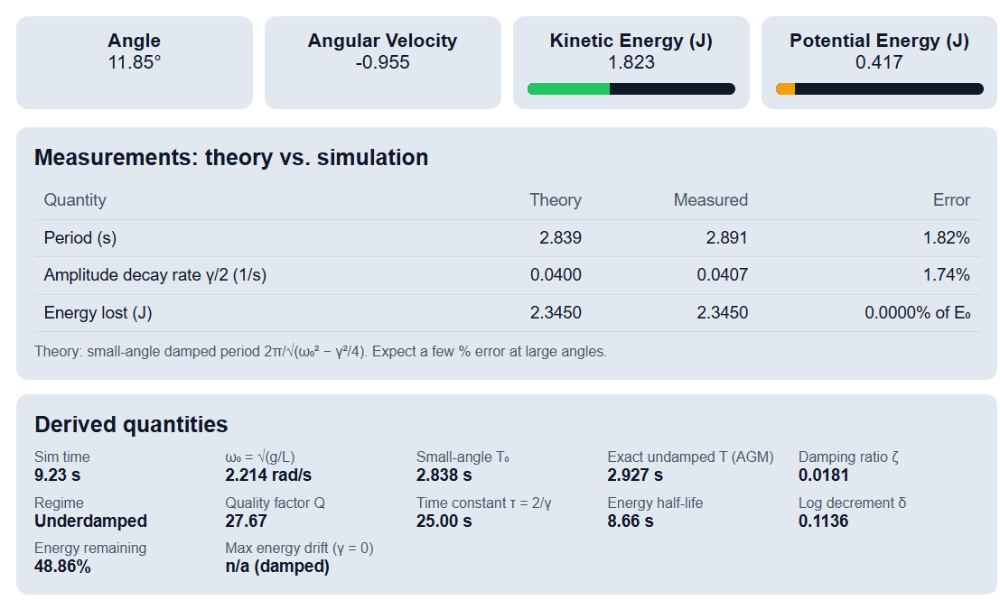

## Damped Pendulum Physics Lab

Length (m):

Gravity:

Initial Angle:

Damping γ:

Integrator: RK4, fixed step h = 4 ms, driven by real elapsed time, so speed is independent of monitor refresh rate. Mass = 1 kg.

#### Angle

0°

#### Angular Velocity

0

#### Kinetic Energy (J)

0

#### Potential Energy (J)

0

### Measurements: theory vs. simulation

| Quantity | Theory | Measured | Error |
| --- | --- | --- | --- |
| Period (s) | – | – | – |
| Amplitude decay rate γ/2 (1/s) | – | – | – |
| Energy lost (J) | – | – | – |

### Derived quantities

Sim time**0**

ω₀ = √(g/L)**–**

Small-angle T₀**–**

Exact undamped T (AGM)**–**

Damping ratio ζ**–**

Regime**–**

Quality factor Q**–**

Time constant τ = 2/γ**–**

Energy half-life**–**

Log decrement δ**–**

Energy remaining**–**

Max energy drift (γ = 0)**–**
